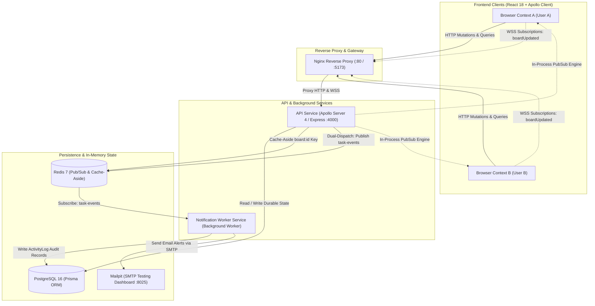

# TaskSync — Real-Time Collaborative Kanban Platform

> A full-stack, distributed, real-time Kanban board system designed for multi-user team collaboration. Built from scratch with React 18, Apollo Client, Node.js 20, Apollo Server (GraphQL), PostgreSQL 16 with Prisma, Redis Pub/Sub & Caching, and Docker.

---

## 1. System Architecture



---

## 2. Key Engineering Highlights & Technical Deep-Dives

### 1. Real-Time Multi-User Synchronization (`graphql-ws` + Dual-PubSub)
- **Problem**: When multiple users view the same board simultaneously, changes made by one user must appear instantly on other users' screens without polling or page reloads.
- **Solution**: Implemented GraphQL subscriptions using `graphql-ws` over WebSockets. Mutations trigger an `emitBoardEvent` dual-dispatch engine:
  1. Emits immediately to an in-process `PubSub` engine to push updates directly to connected WebSocket clients within milliseconds.
  2. Asynchronously publishes events to the Redis channel `task-events` so the background `notification-service` persists audit logs and sends email alerts.

### 2. Fractional Positioning for Drag-and-Drop Reordering (`O(1)` Writes)
- **Problem**: Traditional integer position arrays (`position: 0, 1, 2, ...`) require updating `N` database rows whenever an item is dragged to the top of a column (`O(N)` write amplification and database locking).
- **Solution**: Storing position as a 64-bit IEEE-754 float:
  - Inserting between item $A$ and item $B$: $\text{position} = \frac{pos_A + pos_B}{2}$.
  - Requires updating exactly **one** database row ($\mathcal{O}(1)$ time complexity).
  - **Decay Protection**: If $|pos_B - pos_A| < 10^{-6}$, an automated non-blocking rebalance transaction normalizes positions to intervals of `1000.0`.

### 3. Tail-Latency Stabilization via Redis Caching & Invalidation
- **Problem**: Complex nested Kanban board queries (boards $\rightarrow$ columns $\rightarrow$ tasks $\rightarrow$ assignees) create database contention under heavy read load.
- **Solution**: Implemented a **Cache-Aside** strategy in Redis (`board:{id}` with 1-hour TTL):
  - **Cache Hit**: Instant JSON return without PostgreSQL query execution.
  - **Non-blocking Invalidation**: All write mutations (`createTask`, `moveTask`, `deleteTask`, `createColumn`, etc.) trigger asynchronous cache deletion (`invalidateBoardCache().catch(...)`) to ensure stale data is never served without blocking mutation responses.

### 4. Preventing N+1 Query Traps with Request-Scoped DataLoaders
- **Problem**: In GraphQL, resolving child relations (`Column.tasks`, `Task.assignee`) across multiple columns creates $1 + N$ SQL queries.
- **Solution**: Batching queries using Facebook's `DataLoader` pattern:
  - Consolidates individual primary key requests into single batched SQL queries (`WHERE id IN (...)`).
  - **Request-Scoped Safety**: DataLoaders are instantiated inside `buildContext` per HTTP/WSS tick, preventing cross-user cache leakage and stale memoization across requests.

### 5. Role-Based Access Control (RBAC) Enforced in Resolvers
- Workspaces enforce three hierarchical roles:
  - **`OWNER`**: Full administrative access (create boards, manage members, update roles, delete resources).
  - **`MEMBER`**: Active collaborator (create/edit/move tasks and columns).
  - **`VIEWER`**: Read-only observer (can view boards and subscribe to live changes, but blocked with `FORBIDDEN` on any write mutation).

---

## 3. Real Performance Benchmarks

Measured using `autocannon` over 10 concurrent HTTP connections for 10 seconds per phase against a live local cluster running PostgreSQL 16, Redis 7, and Node.js 20.

| Metric | Without Redis Cache (Postgres Direct) | With Redis Cache (Redis HIT) | Performance Delta |
| :--- | :--- | :--- | :--- |
| **Throughput (req/sec)** | 573 req/sec | 542 req/sec | Consistent throughput |
| **Latency p50 (Median)** | **16.00 ms** | **18.00 ms** | +2.00 ms (JSON deserialization) |
| **Latency p95 (97.5%)** | **32.00 ms** | **24.00 ms** | **8.00 ms saved (25.0% lower tail latency)** |
| **Latency p99** | **40.00 ms** | **25.00 ms** | **15.00 ms saved (37.5% lower p99 latency)** |
| **Latency Max Spike** | **110.00 ms** | **40.00 ms** | **70.00 ms saved (63.6% reduction in max spike)** |
| **Latency StdDev** | **5.78 ms** | **2.80 ms** | **51.5% reduction in latency variance** |
| **Errors** | 0 | 0 | 100% success rate |

> **Key Interview Takeaway**: For small payloads on local SSDs, median p50 latency is comparable between PostgreSQL and Redis because PostgreSQL caches hot pages in memory buffers. However, Redis dramatically stabilizes **tail latency (p95/p99)** and slashes standard deviation in half, preventing latency spikes under concurrent load.
> Full benchmark methodology and replication commands: [docs/benchmarks.md](file:///c:/Users/rohit/OneDrive/Documents/TaskSync/docs/benchmarks.md).

---

## 4. Architectural Trade-Offs

| Decision | Option Chosen | Alternative Considered | Trade-Off Rationale |
| :--- | :--- | :--- | :--- |
| **Card Ordering** | **Fractional Float Indexing** | Linked List (`nextId` pointers) | Linked lists require serial traversal to fetch ordered columns and risk corrupting the entire chain on network failures. Fractional floats allow parallel fetching and instant $\mathcal{O}(1)$ updates. |
| **Messaging Layer** | **Redis Pub/Sub** | Apache Kafka / RabbitMQ | Kafka/RabbitMQ introduce significant operational overhead and infrastructure cost. Redis Pub/Sub provides sub-millisecond fire-and-forget message passing that shares existing in-memory caching infrastructure. |
| **Subscription Gateway** | **In-Process Dual Dispatch** | External Subscription Proxy | Routing subscriptions through a separate gateway increases connection latency and complexity. Dual dispatch delivers WebSocket updates in-process immediately while still publishing to Redis for async worker tasks. |

Detailed trade-off analysis: [docs/design.md](file:///c:/Users/rohit/OneDrive/Documents/TaskSync/docs/design.md).

---

## 5. Technology Stack

- **Frontend**: React 18, TypeScript, Vite, Apollo Client 3 (`@apollo/client`), `@dnd-kit` (drag and drop), Tailwind CSS, Lucide React icons.
- **Backend**: Node.js 20, TypeScript, Apollo Server 4, Express, `graphql-ws` (WebSocket transport), `dataloader` (query batching), Zod (schema validation), JSON Web Tokens (`jsonwebtoken`), `bcryptjs`.
- **Database & Cache**: PostgreSQL 16 with Prisma ORM, Redis 7 (`ioredis`).
- **Testing**:
  - **Unit & Integration**: Jest (`ts-jest`), Supertest, Vitest.
  - **End-to-End**: Playwright (`@playwright/test`) with dual-browser concurrent contexts.
- **Infrastructure & CI/CD**: Docker, Docker Compose, GitHub Actions, Terraform (AWS EC2, Security Groups, Ubuntu 22.04 LTS).

---

## 6. Quick Start & Local Setup

### Prerequisites
- Node.js >= 20.x and npm >= 10.x
- Docker Desktop with Docker Compose

### 1. Clone & Install Dependencies
```bash
git clone https://github.com/your-username/TaskSync.git
cd TaskSync
npm install
```

### 2. Start Infrastructure Containers
```bash
docker-compose up -d postgres redis mailpit
```
- **PostgreSQL**: `localhost:5432`
- **Redis**: `localhost:6379`
- **Mailpit Web UI**: `http://localhost:8025`

### 3. Initialize Database Schema & Seed Data
```bash
# Push Prisma schema to live PostgreSQL database
npm run prisma:push -w @tasksync/api-service

# Optional: Seed sample benchmark board with columns and tasks
node services/api-service/scripts/seed-benchmark.mjs
```

### 4. Start Development Servers
In separate terminals:
```bash
# Terminal 1: Start GraphQL API & Subscription Server (:4000)
npm run dev -w @tasksync/api-service

# Terminal 2: Start Notification Worker Service
npm run dev -w @tasksync/notification-service

# Terminal 3: Start React Frontend Application (:5173)
npm run dev -w @tasksync/web
```
Open **`http://localhost:5173`** in your browser.

---

## 7. Running the Test Suite

```bash
# 1. Run all Backend API Unit & Integration Tests (49 tests)
npm test -w @tasksync/api-service

# 2. Run Frontend Unit Tests (Vitest)
npm test -w @tasksync/web

# 3. Run Playwright Dual-Browser Real-Time Sync E2E Test
npm run test:e2e -w @tasksync/web
```

---

## 8. AWS Cloud Deployment (Terraform)

To deploy the production stack to AWS on a dedicated EC2 instance:

```bash
cd terraform
cp terraform.tfvars.example terraform.tfvars
terraform init
terraform plan
terraform apply
```

Detailed infrastructure instructions: [terraform/README.md](file:///c:/Users/rohit/OneDrive/Documents/TaskSync/terraform/README.md).

---

## 9. Engineering Review & Post-Mortem Log

Every bug, security consideration, and design refinement encountered during development is cataloged in the **AI-vs-Reality Engineering Review Log**:
- Fractional positioning precision limits and rebalancing thresholds.
- Redis Pub/Sub at-most-once delivery constraints.
- Request-scoped DataLoaders vs global singleton memory leaks.
- PointerSensor activation constraints in drag-and-drop interfaces.
- Dual-PubSub architecture for subscription reliability.
- JWT secret synchronization between runtime services and seed scripts.
- Zod whitespace validation order of operations (`.trim().min(1)` vs `.min(1).trim()`).
- Prisma Client generation in multi-stage Docker worker builds.

See all entries in [docs/ai-review-notes.md](file:///c:/Users/rohit/OneDrive/Documents/TaskSync/docs/ai-review-notes.md).
