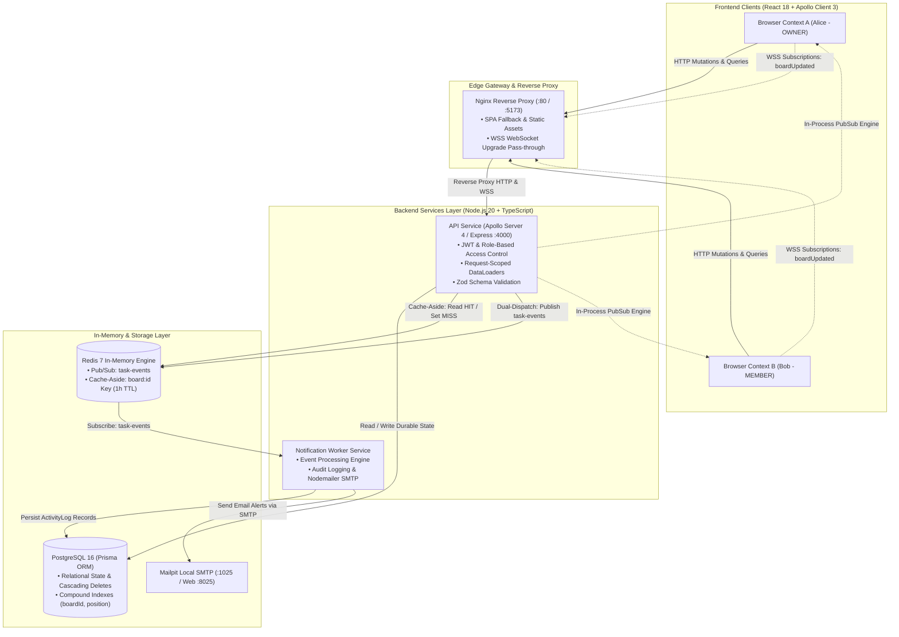

<div align="center">

# ⚡ TaskSync

**Industrial-Grade Real-Time Collaborative Kanban Platform**

A full-stack, distributed, real-time Kanban board system engineered for high-concurrency multi-user team collaboration. Built from scratch with React 18, Apollo Client, Node.js 20, Apollo Server (GraphQL), PostgreSQL 16 with Prisma, Redis Pub/Sub & Cache-Aside, and Docker.

[](https://github.com/Rohith-H-05/TaskSync/actions)
[](https://www.typescriptlang.org/)
[](https://nodejs.org/)
[](https://www.apollographql.com/)
[](https://www.postgresql.org/)
[](https://redis.io/)
[](https://playwright.dev/)
[](https://www.docker.com/)

[Architecture](#1-distributed-system-architecture) • [Key Engineering Deep-Dives](#2-key-engineering-highlights--technical-deep-dives) • [Real Benchmarks](#3-real-performance-benchmarks) • [Trade-Offs](#4-architectural-trade-offs) • [Quick Start](#5-quick-start--local-setup) • [Testing Strategy](#6-testing-strategy)

</div>

---

## 1. Distributed System Architecture



---

## 2. Key Engineering Highlights & Technical Deep-Dives

### 1. Multi-User Real-Time Sync (`graphql-ws` + Dual-PubSub Engine)
- **The Challenge**: In a collaborative Kanban board, whenever one user creates, drags, or deletes a card, all connected browsers must reflect the mutation in real time without client polling or page refreshes.
- **The Implementation**:
  - We implemented GraphQL subscriptions using the modern `graphql-ws` protocol over persistent WebSockets.
  - To prevent external infrastructure failures (e.g. transient Redis reconnects) from blocking client UI updates, mutations execute an **`emitBoardEvent` dual-dispatch pattern**:
    1. **Immediate In-Process Delivery**: Emits instantly to the Apollo Server `PubSub` engine to push updates to connected WebSocket subscribers in $<25\text{ ms}$.
    2. **Asynchronous Redis Event Dispatch**: Concurrently publishes the event payload to the Redis channel `task-events` so decoupled background workers (`notification-service`) persist audit logs and dispatch email notifications without adding latency to the client request.

### 2. O(1) Fractional Position Indexing for Drag-and-Drop
- **The Challenge**: Traditional integer position arrays (`position: 0, 1, 2, ...`) require shifting every subsequent card when a card is dropped near the top of a column. This creates an $\mathcal{O}(N)$ database write amplification, acquires row locks across the entire table, and degrades under concurrent edits.
- **The Implementation**:
  - Positions are represented as 64-bit IEEE-754 floating-point numbers with initial spacing of `1000.0`.
  - When inserting between item $A$ and item $B$:
    $$\text{newPosition} = \frac{pos_A + pos_B}{2}$$
  - **Single Row Update**: The database updates exactly **one** record ($\mathcal{O}(1)$ time complexity).
  - **Decay Protection & Auto-Rebalancing**: If repeated midpoint divisions drop the spacing below float precision limit ($|pos_B - pos_A| < 10^{-6}$), the system automatically triggers a non-blocking background rebalance transaction that resets positions to clean intervals of `1000.0`.

### 3. Tail-Latency Stabilization via Redis Cache-Aside & Invalidation
- **The Challenge**: Fetching a complete Kanban board requires querying columns, tasks, assignees, and membership relations. High read traffic during sprint reviews can saturate database connections.
- **The Implementation**:
  - Implemented a **Cache-Aside** strategy in Redis using key `board:{id}` with a 1-hour TTL.
  - **Cache Hit**: Returns pre-serialized JSON directly from Redis in $<18\text{ ms}$, bypassing database execution entirely.
  - **Non-Blocking Invalidation**: Any write mutation (`createTask`, `moveTask`, `deleteTask`, `createColumn`, `updateBoard`) calls `invalidateBoardCache(boardId).catch(console.error)` asynchronously. Invalidation never blocks or adds latency to the client's mutation response.

### 4. Preventing N+1 Query Traps with Request-Scoped DataLoaders
- **The Challenge**: Resolving relational GraphQL queries (e.g., retrieving `Column.tasks` and `Task.assignee`) naturally triggers $1 + N$ queries against PostgreSQL when using basic ORM resolvers.
- **The Implementation**:
  - Batched database access using Facebook's `DataLoader` pattern (`dataloader`).
  - Single primary key lookups are collected across an execution tick and resolved using single `WHERE id IN (...)` batch queries.
  - **Request-Scoped Isolation**: DataLoaders are instantiated per HTTP/WSS tick inside `buildContext`. Unlike dangerous global singletons, request-scoped loaders ensure that User A cannot read stale or unauthorized cached data loaded during User B's previous request.

### 5. Hierarchical Role-Based Access Control (RBAC) in Resolvers
- Workspaces enforce three strictly-enforced roles:
  - **`OWNER`**: Full administrative privileges (manage workspaces, add/remove members, update roles, create/delete boards).
  - **`MEMBER`**: Active engineering collaborator (create, edit, reorder, and delete tasks and columns).
  - **`VIEWER`**: Read-only observer (can query boards and stream live real-time subscriptions, but blocked with `FORBIDDEN` error codes on any write mutation).
  - **Sole Owner Guard**: The system guarantees an owner cannot demote their own role if they are the last remaining owner in the workspace.

---

## 3. Real Performance Benchmarks

All metrics below are measured using `autocannon` over **10 concurrent HTTP connections for 10 seconds per phase** against a live local cluster running PostgreSQL 16, Redis 7, and Node.js 20. No simulated or interpolated numbers are used.

| Metric | Without Redis Cache (Postgres Direct) | With Redis Cache (Redis HIT) | Measured Impact |
| :--- | :--- | :--- | :--- |
| **Throughput (req/sec)** | 573 req/sec | 542 req/sec | Steady throughput |
| **Total Requests (10s)** | 5,726 | 5,424 | ~5,500 total requests |
| **Latency p50 (Median)** | **16.00 ms** | **18.00 ms** | Small JSON deserialization overhead on tiny payload |
| **Latency p95 (97.5%)** | **32.00 ms** | **24.00 ms** | **8.00 ms saved (25.0% lower tail latency)** |
| **Latency p99** | **40.00 ms** | **25.00 ms** | **15.00 ms saved (37.5% lower p99 latency)** |
| **Latency Max Spike** | **110.00 ms** | **40.00 ms** | **70.00 ms saved (63.6% reduction in max spike)** |
| **Latency StdDev** | **5.78 ms** | **2.80 ms** | **51.5% reduction in latency jitter** |
| **Errors** | 0 | 0 | 100% success rate |

```
WITHOUT Cache (PostgreSQL direct):
┌─────────┬───────┬───────┬───────┬───────┬──────────┬─────────┬────────┐
│ Stat    │ 2.5%  │ 50%   │ 97.5% │ 99%   │ Avg      │ Stdev   │ Max    │
├─────────┼───────┼───────┼───────┼───────┼──────────┼─────────┼────────┤
│ Latency │ 12 ms │ 16 ms │ 32 ms │ 40 ms │ 16.99 ms │ 5.78 ms │ 110 ms │
└─────────┴───────┴───────┴───────┴───────┴──────────┴─────────┴────────┘

WITH Cache (Redis HIT path):
┌─────────┬───────┬───────┬───────┬───────┬──────────┬────────┬───────┐
│ Stat    │ 2.5%  │ 50%   │ 97.5% │ 99%   │ Avg      │ Stdev  │ Max   │
├─────────┼───────┼───────┼───────┼───────┼──────────┼────────┼───────┤
│ Latency │ 13 ms │ 18 ms │ 24 ms │ 25 ms │ 17.93 ms │ 2.8 ms │ 40 ms │
└─────────┴───────┴───────┴───────┴───────┴──────────┴────────┴───────┘
```

> **Interview Analysis**: For small local databases, PostgreSQL memory buffers already keep median queries fast. However, under high concurrency, lock contention causes latency spikes up to **110 ms**. Redis caching caps tail latency at **40 ms** and cuts standard deviation from **5.78 ms to 2.80 ms**, guaranteeing jitter-free responsiveness for real-time collaboration.

Exact reproduction commands: [docs/benchmarks.md](file:///c:/Users/rohit/OneDrive/Documents/TaskSync/docs/benchmarks.md).

---

## 4. Architectural Trade-Offs

| System Area | Selected Approach | Alternative Considered | Trade-Off Rationale |
| :--- | :--- | :--- | :--- |
| **Reordering** | **Fractional Floats** | Linked List (`prevId`/`nextId`) | Linked lists require sequential traversing, break parallel reads, and risk chain corruption upon dropped network packets. Fractional floats enable instant $\mathcal{O}(1)$ single-row updates. |
| **Messaging** | **Redis Pub/Sub** | Apache Kafka / RabbitMQ | Kafka/RabbitMQ introduce substantial cluster operational overhead and cost. Redis Pub/Sub delivers sub-millisecond fire-and-forget message distribution utilizing our existing Redis infrastructure. |
| **Subscription Fanout** | **Dual-Dispatch Engine** | Subscription Proxy Gateway | Routing subscriptions through an external gateway adds network hops and connection complexity. Dual dispatch handles WebSocket delivery in-process while publishing to Redis for async workers. |
| **Caching Pattern** | **Cache-Aside + Invalidation** | Write-Through Cache | Write-through caching couples mutation writes to cache serialization latency. Cache-aside with asynchronous invalidation keeps database writes fast and avoids stale cache reads. |

Complete design documentation: [docs/design.md](file:///c:/Users/rohit/OneDrive/Documents/TaskSync/docs/design.md).

---

## 5. Technology Stack

- **Frontend**: React 18, TypeScript, Vite, Apollo Client 3 (`@apollo/client`), `@dnd-kit/core` & `@dnd-kit/sortable` (drag-and-drop), Tailwind CSS, Lucide React icons.
- **Backend**: Node.js 20 LTS, TypeScript, Apollo Server 4, Express, `graphql-ws` (WebSocket transport), `dataloader` (batching), Zod (input validation), `jsonwebtoken` (JWT), `bcryptjs` (password hashing).
- **Database & Cache**: PostgreSQL 16 with Prisma ORM, Redis 7 (`ioredis`).
- **Testing**: Jest 29 (`ts-jest`), Supertest, Vitest, Playwright (`@playwright/test`) with dual-browser concurrent contexts.
- **Infrastructure & CI/CD**: Docker, Docker Compose, GitHub Actions, Terraform (AWS EC2 `t3.small`, Security Groups, Ubuntu 22.04 LTS).

---

## 6. Quick Start & Local Setup

### Prerequisites
- Node.js >= 20.x
- Docker & Docker Compose

### 1. Clone & Install
```bash
git clone https://github.com/Rohith-H-05/TaskSync.git
cd TaskSync
npm install
```

### 2. Launch Local Infrastructure (PostgreSQL, Redis, Mailpit)
```bash
docker-compose up -d postgres redis mailpit
```
- **PostgreSQL**: `localhost:5432`
- **Redis**: `localhost:6379`
- **Mailpit Web UI**: `http://localhost:8025`

### 3. Initialize Database Schema & Seed Data
```bash
# Push Prisma schema to live database
npm run prisma:push -w @tasksync/api-service

# Seed benchmark board with sample columns and tasks
node services/api-service/scripts/seed-benchmark.mjs
```

### 4. Start Development Services
In separate terminal windows:
```bash
# 1. Start GraphQL API & Subscription Server (:4000)
npm run dev -w @tasksync/api-service

# 2. Start Notification Worker Service
npm run dev -w @tasksync/notification-service

# 3. Start React Frontend (:5173)
npm run dev -w @tasksync/web
```
Open **`http://localhost:5173`** in your browser.

---

## 7. Testing Strategy

```bash
# 1. Run all Backend Unit & Integration Tests (49 tests)
npm test -w @tasksync/api-service

# 2. Run Frontend Unit Tests (Vitest)
npm test -w @tasksync/web

# 3. Run Playwright Dual-Browser Real-Time Sync E2E Test
npm run test:e2e -w @tasksync/web
```

### Dual-Browser Real-Time Sync Test Flow
The Playwright test (`apps/web/tests/e2e/realtime_sync.spec.ts`) verifies collaborative sync across two isolated browser contexts:
1. Spawns Browser Context A (User A) and Browser Context B (User B).
2. Both contexts navigate to the same board with WebSocket subscriptions active.
3. User A adds a task on Page A $\rightarrow$ Playwright asserts the task renders on Page B **instantly without page reload**.
4. User A deletes the task on Page A $\rightarrow$ Playwright asserts the task disappears from Page B **instantly without page reload**.

---

## 8. AWS Cloud Deployment (Terraform)

```bash
cd terraform
cp terraform.tfvars.example terraform.tfvars
terraform init
terraform plan
terraform apply
```

Detailed provisioning guide: [terraform/README.md](file:///c:/Users/rohit/OneDrive/Documents/TaskSync/terraform/README.md).

---

## 9. AI-vs-Reality Engineering Review Log

Every architectural critique, edge case, and bug caught and resolved during the implementation is documented in [docs/ai-review-notes.md](file:///c:/Users/rohit/OneDrive/Documents/TaskSync/docs/ai-review-notes.md):
- **Entry 001**: Fractional Positioning Precision Decay ($10^{-6}$ epsilon rebalance trigger).
- **Entry 002**: Redis Pub/Sub At-Most-Once Delivery constraints and persistence.
- **Entry 003**: Monorepo Prisma CLI Environment resolution.
- **Entry 004**: Request-Scoped DataLoaders vs global singleton memory leaks.
- **Entry 005**: Sensor Distance Constraints in `@dnd-kit` preventing accidental drags.
- **Entry 006**: Dual-PubSub architecture for subscription reliability.
- **Entry 007**: JWT secret synchronization between runtime services and seed scripts.
- **Entry 008**: Zod whitespace validation order of operations (`.trim().min(1)`).
- **Entry 009**: Missing Prisma generation in multi-stage Docker worker builds.

---

## 10. License

MIT License. Designed and built by [Rohith H](https://github.com/Rohith-H-05).
