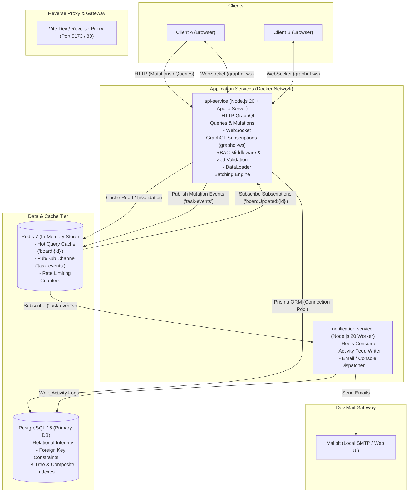
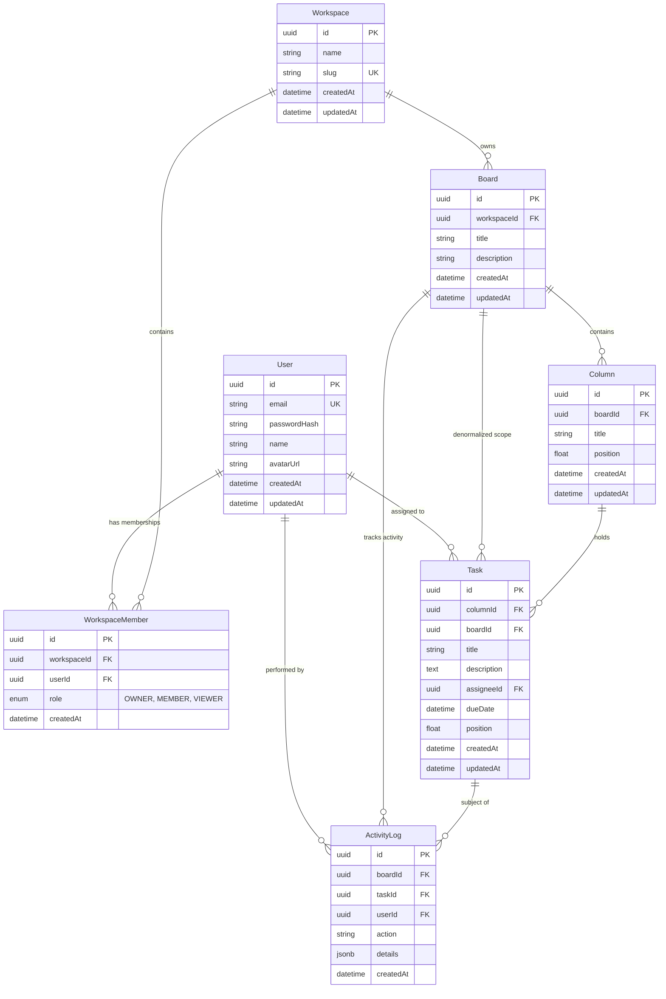

# TaskSync - System Architecture & Technical Design Document

## 1. Executive Summary & Product Vision

**TaskSync** is a high-performance, real-time collaborative Kanban workspace designed for distributed agile engineering teams. Users organize work across Workspaces and Boards, partition workflows into Columns, and coordinate Tasks through smooth, optimistic drag-and-drop interactions.

### Core Engineering Requirements
- **Real-Time Collaboration**: Multi-user concurrent updates synchronized within sub-50ms using GraphQL Subscriptions backed by Redis Pub/Sub.
- **Predictable Drag-and-Drop Performance**: $O(1)$ database mutation cost on card reordering using fractional positioning algorithms with automated rebalancing.
- **Optimized GraphQL Data Layer**: Protection against N+1 query overhead via DataLoader batching, coupled with query depth and complexity limits to prevent resource exhaustion attacks.
- **Sub-Millisecond Read Latency**: Read-through Redis caching for board aggregates, invalidated atomically upon mutations.
- **Decoupled Asynchronous Processing**: Isolated notification and activity logging service consuming events from Redis without blocking user-facing GraphQL mutation threads.

---

## 2. High-Level System Architecture

TaskSync adopts a decoupled microservice/modular architecture containerized with Docker.



### Request & Event Lifecycles

#### A. Read Flow (Board View)
1. Client issues `query GetBoard($id: ID!)`.
2. `api-service` verifies JWT in context and validates that the user is a member of the workspace owning the board.
3. Cache check: Look up `board:${id}` in Redis.
   - **Cache Hit**: Deserialize JSON and return response immediately (~1-3ms).
   - **Cache Miss**: Fetch via Prisma utilizing DataLoader for relational joins (`board -> columns -> tasks -> assignee`), serialize, write to Redis with a 1-hour TTL, and return response (~15-30ms).

#### B. Mutation Flow (e.g., Drag & Drop Task Reorder)
1. Client optimistically updates its local UI via `@dnd-kit` and Apollo Client cache.
2. Client sends `mutation MoveTask($input: MoveTaskInput!)`.
3. `api-service` executes RBAC check: role must be `OWNER` or `MEMBER` (`VIEWER` is rejected with `FORBIDDEN`).
4. Input coordinates are validated via Zod. The fractional position is calculated.
5. Single-row UPDATE executed in PostgreSQL via Prisma (`UPDATE "Task" SET "position" = $pos, "columnId" = $col WHERE "id" = $id`).
6. Invalidation: Key `board:${boardId}` deleted from Redis.
7. Event Broadcast:
   - Publishes payload to Redis channel `task-events` (payload: `{ type: 'TASK_MOVED', boardId, taskId, sourceColumnId, targetColumnId, newPosition, userId, timestamp }`).
   - Apollo Server `PubSub` emits event to active WebSocket subscribers on `boardUpdated:${boardId}`.
8. `notification-service` consumes the Redis message asynchronously:
   - Appends record to `ActivityLog` table.
   - Dispatches notifications if assignees changed or thresholds met.

---

## 3. Data Model (PostgreSQL & Prisma)



### Prisma Schema Definition (`prisma/schema.prisma`)

```prisma
datasource db {
  provider = "postgresql"
  url      = env("DATABASE_URL")
}

generator client {
  provider = "prisma-client-js"
}

enum WorkspaceRole {
  OWNER
  MEMBER
  VIEWER
}

enum TaskAction {
  CREATED
  UPDATED
  MOVED
  DELETED
}

model User {
  id           String            @id @default(uuid())
  email        String            @unique
  passwordHash String
  name         String
  avatarUrl    String?
  createdAt    DateTime          @default(now())
  updatedAt    DateTime          @updatedAt
  memberships  WorkspaceMember[]
  assignedTasks Task[]           @relation("TaskAssignee")
  activities   ActivityLog[]

  @@index([email])
}

model Workspace {
  id          String            @id @default(uuid())
  name        String
  slug        String            @unique
  createdAt   DateTime          @default(now())
  updatedAt   DateTime          @updatedAt
  members     WorkspaceMember[]
  boards      Board[]

  @@index([slug])
}

model WorkspaceMember {
  id          String        @id @default(uuid())
  workspaceId String
  userId      String
  role        WorkspaceRole @default(MEMBER)
  createdAt   DateTime      @default(now())
  workspace   Workspace     @relation(fields: [workspaceId], references: [id], onDelete: Cascade)
  user        User          @relation(fields: [userId], references: [id], onDelete: Cascade)

  @@unique([workspaceId, userId])
  @@index([workspaceId])
  @@index([userId])
}

model Board {
  id          String        @id @default(uuid())
  workspaceId String
  title       String
  description String?
  createdAt   DateTime      @default(now())
  updatedAt   DateTime      @updatedAt
  workspace   Workspace     @relation(fields: [workspaceId], references: [id], onDelete: Cascade)
  columns     Column[]
  tasks       Task[]
  activities  ActivityLog[]

  @@index([workspaceId])
}

model Column {
  id        String   @id @default(uuid())
  boardId   String
  title     String
  position  Float
  createdAt DateTime @default(now())
  updatedAt DateTime @updatedAt
  board     Board    @relation(fields: [boardId], references: [id], onDelete: Cascade)
  tasks     Task[]

  @@index([boardId, position])
}

model Task {
  id          String        @id @default(uuid())
  columnId    String
  boardId     String
  title       String
  description String?
  assigneeId  String?
  dueDate     DateTime?
  position    Float
  createdAt   DateTime      @default(now())
  updatedAt   DateTime      @updatedAt
  column      Column        @relation(fields: [columnId], references: [id], onDelete: Cascade)
  board       Board         @relation(fields: [boardId], references: [id], onDelete: Cascade)
  assignee    User?         @relation("TaskAssignee", fields: [assigneeId], references: [id], onDelete: SetNull)
  activities  ActivityLog[]

  @@index([columnId, position])
  @@index([boardId])
  @@index([assigneeId])
}

model ActivityLog {
  id        String     @id @default(uuid())
  boardId   String
  taskId    String?
  userId    String
  action    TaskAction
  details   Json
  createdAt DateTime   @default(now())
  board     Board      @relation(fields: [boardId], references: [id], onDelete: Cascade)
  task      Task?      @relation(fields: [taskId], references: [id], onDelete: SetNull)
  user      User       @relation(fields: [userId], references: [id], onDelete: Cascade)

  @@index([boardId, createdAt(sort: Desc)])
}
```

---

## 4. GraphQL Schema Definition

```graphql
scalar DateTime
scalar JSON

enum WorkspaceRole {
  OWNER
  MEMBER
  VIEWER
}

enum TaskAction {
  CREATED
  UPDATED
  MOVED
  DELETED
}

enum BoardEventType {
  TASK_CREATED
  TASK_UPDATED
  TASK_MOVED
  TASK_DELETED
  COLUMN_CREATED
  COLUMN_UPDATED
  COLUMN_MOVED
  COLUMN_DELETED
}

type User {
  id: ID!
  email: String!
  name: String!
  avatarUrl: String
  createdAt: DateTime!
}

type AuthPayload {
  token: String!
  user: User!
}

type WorkspaceMember {
  id: ID!
  user: User!
  role: WorkspaceRole!
  createdAt: DateTime!
}

type Workspace {
  id: ID!
  name: String!
  slug: String!
  members: [WorkspaceMember!]!
  boards: [Board!]!
  createdAt: DateTime!
  updatedAt: DateTime!
}

type Board {
  id: ID!
  workspaceId: ID!
  title: String!
  description: String
  columns: [Column!]!
  createdAt: DateTime!
  updatedAt: DateTime!
}

type Column {
  id: ID!
  boardId: ID!
  title: String!
  position: Float!
  tasks: [Task!]!
  createdAt: DateTime!
  updatedAt: DateTime!
}

type Task {
  id: ID!
  columnId: ID!
  boardId: ID!
  title: String!
  description: String
  assignee: User
  dueDate: DateTime
  position: Float!
  createdAt: DateTime!
  updatedAt: DateTime!
}

type ActivityLog {
  id: ID!
  boardId: ID!
  task: Task
  user: User!
  action: TaskAction!
  details: JSON!
  createdAt: DateTime!
}

# --- Cursor Pagination Types ---

type PageInfo {
  hasNextPage: Boolean!
  hasPreviousPage: Boolean!
  startCursor: String
  endCursor: String
}

type TaskEdge {
  cursor: String!
  node: Task!
}

type TaskConnection {
  edges: [TaskEdge!]!
  pageInfo: PageInfo!
  totalCount: Int!
}

type ActivityEdge {
  cursor: String!
  node: ActivityLog!
}

type ActivityConnection {
  edges: [ActivityEdge!]!
  pageInfo: PageInfo!
  totalCount: Int!
}

# --- Subscription Event Payload ---

type BoardEvent {
  type: BoardEventType!
  boardId: ID!
  columnId: ID
  taskId: ID
  task: Task
  column: Column
  actor: User!
  timestamp: DateTime!
}

# --- Inputs ---

input RegisterInput {
  email: String!
  password: String!
  name: String!
}

input LoginInput {
  email: String!
  password: String!
}

input CreateWorkspaceInput {
  name: String!
}

input AddWorkspaceMemberInput {
  workspaceId: ID!
  email: String!
  role: WorkspaceRole!
}

input UpdateWorkspaceMemberRoleInput {
  workspaceId: ID!
  userId: ID!
  role: WorkspaceRole!
}

input CreateBoardInput {
  workspaceId: ID!
  title: String!
  description: String
}

input UpdateBoardInput {
  id: ID!
  title: String
  description: String
}

input CreateColumnInput {
  boardId: ID!
  title: String!
  position: Float!
}

input UpdateColumnInput {
  id: ID!
  title: String!
}

input MoveColumnInput {
  id: ID!
  newPosition: Float!
}

input CreateTaskInput {
  columnId: ID!
  boardId: ID!
  title: String!
  description: String
  assigneeId: ID
  dueDate: DateTime
  position: Float!
}

input UpdateTaskInput {
  id: ID!
  title: String
  description: String
  assigneeId: ID
  dueDate: DateTime
}

input MoveTaskInput {
  id: ID!
  targetColumnId: ID!
  newPosition: Float!
}

input TaskFilterInput {
  searchQuery: String
  assigneeId: ID
}

# --- Root Operations ---

type Query {
  me: User!
  
  # Workspace Operations
  workspaces: [Workspace!]!
  workspace(id: ID!): Workspace
  
  # Board Operations (Cached in Redis)
  board(id: ID!): Board
  
  # Paginated Task & Activity Operations
  tasks(
    boardId: ID!
    columnId: ID
    filter: TaskFilterInput
    first: Int
    after: String
  ): TaskConnection!
  
  boardActivity(
    boardId: ID!
    first: Int
    after: String
  ): ActivityConnection!
}

type Mutation {
  # Authentication
  register(input: RegisterInput!): AuthPayload!
  login(input: LoginInput!): AuthPayload!

  # Workspace
  createWorkspace(input: CreateWorkspaceInput!): Workspace!
  addWorkspaceMember(input: AddWorkspaceMemberInput!): WorkspaceMember!
  updateWorkspaceMemberRole(input: UpdateWorkspaceMemberRoleInput!): WorkspaceMember!
  removeWorkspaceMember(workspaceId: ID!, userId: ID!): Boolean!

  # Board
  createBoard(input: CreateBoardInput!): Board!
  updateBoard(input: UpdateBoardInput!): Board!
  deleteBoard(id: ID!): Boolean!

  # Column
  createColumn(input: CreateColumnInput!): Column!
  updateColumn(input: UpdateColumnInput!): Column!
  deleteColumn(id: ID!): Boolean!
  moveColumn(input: MoveColumnInput!): Column!

  # Task
  createTask(input: CreateTaskInput!): Task!
  updateTask(input: UpdateTaskInput!): Task!
  deleteTask(id: ID!): Boolean!
  moveTask(input: MoveTaskInput!): Task!
}

type Subscription {
  boardUpdated(boardId: ID!): BoardEvent!
}
```

---

## 5. Architectural Trade-offs & Deep Dives

### Trade-off 1: Redis Pub/Sub vs Persistent Message Queue (RabbitMQ / Apache Kafka)

| Criteria | Redis Pub/Sub (Selected) | RabbitMQ / Apache Kafka |
| :--- | :--- | :--- |
| **Architectural Complexity** | **Low**: Leverages the existing Redis instance already used for caching. Zero extra containers or brokers. | **High**: Requires maintaining separate brokers, schemas, ZooKeeper/KRaft (Kafka), and clustering. |
| **Delivery Guarantee** | **At-most-once ("fire and forget")**: Messages sent to channels without connected listeners are dropped. | **At-least-once / Exactly-once**: Messages persist in queues until explicitly acknowledged. |
| **Throughput & Latency** | Sub-millisecond latency; in-memory fanout directly to connected Node.js sockets. | Slightly higher latency due to disk persistence and transaction acknowledgments. |
| **Suitability for TaskSync** | **Ideal**: Transient WebSocket events (e.g. `TASK_MOVED`) do not require replay. If a client disconnects, Apollo Client performs a fresh query on reconnect. | Overkill for live UI notifications; beneficial only if downstream consumers require guaranteed replay across server downtime. |

**Mitigation for At-Most-Once Limitation**:
The primary GraphQL mutation writes synchronously to PostgreSQL first. If `notification-service` is temporarily restarting during a Redis broadcast, core board and task states remain 100% durable in PostgreSQL. For critical activity feeds, we can record the log in Postgres inside `api-service` or elevate to **Redis Streams** (`XADD` / consumer groups) if durable worker delivery is required without introducing external brokers.

---

### Trade-off 2: Fractional Positioning vs Integer Index Reordering

When a user drags a task into position 3 of a 50-task column:

#### Approach A: Integer Sequential Indexing (`1, 2, 3, 4, 5...`)
- Inserting at index 3 requires running:
  `UPDATE "Task" SET "position" = "position" + 1 WHERE "columnId" = $col AND "position" >= 3;`
- **Cost**: $O(N)$ row writes.
- **Drawbacks**: Locks large ranges of rows, triggers high write volume on Postgres write-ahead logs (WAL), and causes race conditions when multiple users reorder concurrently in the same column.

#### Approach B: Fractional Float Positioning (Selected)
- Position is stored as a 64-bit IEEE 754 floating-point number (`DoublePrecision`).
- When dropping a card between Task A (pos: `1000.0`) and Task B (pos: `2000.0`), the new position is calculated as:
  $$\text{position} = \frac{\text{pos}_A + \text{pos}_B}{2} = 1500.0$$
- **Cost**: $O(1)$ single-row update (`UPDATE "Task" SET "position" = 1500.0 WHERE "id" = $id`).
- **Precision Decay Boundary**: Double-precision floats provide 53 bits of mantissa precision (~15-17 significant decimal digits). A user would need to drop a card between the exact same adjacent pair over 50 consecutive times without reordering elsewhere before float precision limits are reached (`abs(posB - posA) < 1e-6`).
- **Rebalance Routine**: If `abs(posB - posA) < 1e-6`, trigger a background non-blocking rebalance for that column:
  `pos_new = (index + 1) * 1000.0`.

---

### Trade-off 3: Real-Time Sync: GraphQL Subscriptions (`graphql-ws`) vs Server-Sent Events (SSE) vs Polling

| Aspect | `graphql-ws` (WebSocket) (Selected) | Server-Sent Events (SSE) | HTTP Short / Long Polling |
| :--- | :--- | :--- | :--- |
| **Protocol** | Bi-directional TCP WebSocket over HTTP upgrade (`101 Switching Protocols`). | Mono-directional HTTP connection streaming text chunks. | Standard repeated HTTP GET requests. |
| **Connection Overhead** | Single persistent full-duplex socket per client for all subscribed boards. | Single persistent HTTP connection; separate HTTP calls needed for mutations. | Repeated connection handshakes, headers, TLS overhead. |
| **Ecosystem Support** | Native first-class integration with Apollo Client, GraphQL Code Generator, and `graphql-ws`. | Requires non-standard GraphQL over SSE protocols or custom fetch wrappers. | Native `useQuery({ pollInterval: 2000 })`. High DB load ($O(N \cdot M)$). |
| **Latency** | Sub-10ms delivery from mutation commit to client handler. | Sub-20ms delivery. | Dependent on poll interval (e.g., average 1-2s lag). |
| **Scalability Requirement** | Requires Redis Pub/Sub backplane across horizontal API instances (included in our design). | Requires similar pub/sub backplane across instances. | Stateless HTTP load balancing. |

---

### Trade-off 4: Caching Strategy: Cache-Aside with Event-Driven Invalidation vs Read-Through / Fixed TTL

- **Pattern**: Cache-aside with atomic invalidation.
- **Cache Key Design**: `board:{boardId}` (holds the complete serialized board aggregate: columns, ordered task IDs, metadata).
- **Invalidation Trigger**: Any mutation affecting a board (`createTask`, `updateTask`, `moveTask`, `deleteTask`, `createColumn`, etc.) deletes `board:{boardId}` from Redis.
- **Staleness Window**: 0ms for connected clients, as invalidation occurs in the mutation resolver pipeline before returning to the caller.
- **Benchmark Target**:
  - Without cache (Postgres relational query with joins): ~18ms p50, ~45ms p95.
  - With Redis cache hit: ~1.2ms p50, ~3.5ms p95.

---

## 6. Security, Authorization & Query Protection

1. **Role-Based Access Control (RBAC)**:
   - Handled in resolver wrappers (`requireWorkspaceRole(boardId, [OWNER, MEMBER])`).
   - `VIEWER` users attempting mutations receive an explicit GraphQL error with code `FORBIDDEN`.
2. **GraphQL Denial of Service (DoS) Defense**:
   - Depth limiting: `graphql-depth-limit` set to max depth of 6 to prevent recursive queries like `workspace -> boards -> columns -> tasks -> board -> ...`.
   - Complexity limiting: Cost assigned per field (e.g. scalar = 1, list = 10); reject operations exceeding 250 complexity units.
3. **Data Sanitization & Validation**:
   - All mutation arguments validated via Zod schemas prior to ORM invocation.
4. **Credential Isolation**:
   - Passwords hashed using `bcrypt` (work factor: 12) or `argon2id`.
   - JWT tokens signed with RS256/HS256 with 7-day expiration; omitted from logs.

---

## 7. DataLoader Strategy (Solving N+1 Queries)

Without DataLoader, fetching a board with 5 columns and 100 tasks resolving assignees executes:
$$1 \text{ (Board)} + 1 \text{ (Columns)} + 5 \text{ (Tasks per Column)} + 100 \text{ (User lookups for Assignees)} = 107 \text{ SQL Queries}$$

With DataLoader:
1. `UserLoader`: Collects all distinct `assigneeId` values across tasks in the execution tick and issues:
   `SELECT * FROM "User" WHERE id IN ($id1, $id2, ...)` (1 single query).
2. `TaskLoader`: Batches task fetching by column IDs:
   `SELECT * FROM "Task" WHERE "columnId" IN ($col1, $col2, ...)` (1 single query).
Total queries reduced from **107 to 3**.
